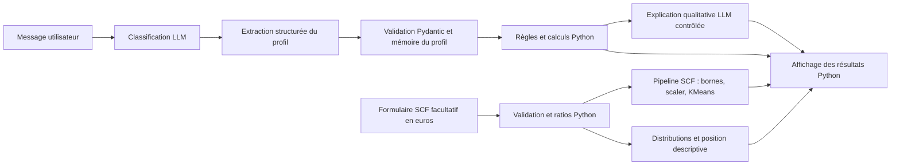

# Assistant finance — reprise V6

Projet de fin de formation Datagong, poursuivant le travail réalisé avec Claude. Le chatbot comprend une demande en français, collecte un profil, applique des règles Python explicites et compare, si les observations sont disponibles, ce profil aux ménages du SCF 2022.

Le LLM sert à comprendre le langage et à expliquer les règles. Python calcule les chiffres et utilise le modèle de clustering. La comparaison statistique ne prescrit pas une allocation optimale. Aucun cours, performance ou signal boursier en direct n'est disponible.

## Démarrer

Environnement validé : Python **3.14.4**, macOS Apple Silicon. Les versions exactes figurent dans `requirements-lock.txt`. Une installation dans un environnement neuf a été effectuée. D'autres systèmes restent à tester.

```bash
python3.14 -m venv .venv
source .venv/bin/activate
python -m pip install -r requirements.txt
python lancer_local.py
```

Le formulaire « Renseigner ou corriger ma situation » fonctionne sans API. Le chat utilise `OPENAI_API_KEY`, depuis l'environnement ou un `.env` local conforme à `.env.example`. Pour réutiliser une configuration conservée ailleurs sans copier la clé :

```bash
python lancer_local.py --env-file /chemin/vers/votre/.env
```

La clé ne doit jamais être ajoutée au dépôt, aux captures ou à une archive. Le programme écoute uniquement sur la machine locale. `OPENAI_MODEL` permet de modifier le modèle ; le modèle déjà utilisé dans le projet (`gpt-5.6-luna`) a été conservé et testé. Le choix d'un autre modèle impose de rejouer les évaluations.

## Comprendre l'architecture



L'orchestrateur est `app/pipeline.py`, commun au terminal et à Streamlit. Les chemins pédagogie, fiscalité, choix d'actifs, timing, données de marché et hors périmètre ont des politiques distinctes. Pendant une collecte, une nouvelle question peut interrompre le formulaire sans perdre le profil.

Le projet reste dans `app/`, comme l'existant : ajouter un dossier `src/` et plusieurs agents n'améliorerait pas sa compréhension. Le code calculé montré par l'interface est la fonction réellement appelée ; ce n'est pas une chaîne de pensée du LLM.

## Comparaison facultative, après l'analyse

Après « Analyser mon épargne », l'application propose « Oui, voir où je me situe » ou « Pas maintenant ». Aucun clustering n'est lancé par Streamlit avant cette étape volontaire.

Le formulaire séparé demande l'âge et des **montants en euros** : épargne totale, part en actions, argent disponible, revenus mensuels avant impôt, valeur totale des biens et dettes restantes. Les aides distinguent les dettes des mensualités et les revenus des dépenses. Python calcule les ratios ; aucune conversion euros/dollars n'est nécessaire.

Quatre histogrammes présentent la position « Vous » et la médiane de l'échantillon : âge, part de l'épargne en actions, liquidités en mois de revenu et dette/biens. Les graphiques décrivent les 4 532 ménages exploitables, non pondérés, du premier implicat SCF 2022. Ce ne sont ni des classements de qualité ni des objectifs à atteindre. Les détails méthodologiques sont repliés, et le graphique peut être téléchargé.

Cette saisie reste locale et séparée de la mémoire envoyée au LLM. Le modèle de clustering existant est toujours utilisé après validation du formulaire ; son éventuelle abstention n'empêche pas de montrer la distribution descriptive.

La logique Python historique reste compatible : `calculer`, `analyser_profil` et `traiter` acceptent `inclure_comparaison=False`, utilisé par Streamlit. Leurs appels directs conservent le comportement V6 par défaut. Voir `reports/evolution_comparaison_scf.md` et `reports/tests_comparaison_scf.log` pour cette évolution de l'interface.

## Ce que signifie le clustering

Les cinq informations de base sont le capital ponctuel, l'horizon, la tolérance déclarée, l'épargne en mois de **dépenses** et la résidence fiscale. Quatre observations facultatives sont définies dans le même `Profil` :

| Champ | Sens | Jamais remplacé par |
|---|---|---|
| `age` | Âge explicitement renseigné | Un âge moyen arbitraire |
| `part_actions_actuelle` | Actions directes/indirectes divisées par le patrimoine financier | La tolérance ou une allocation souhaitée |
| `liquidites_mois_revenu` | Liquidités divisées par le revenu mensuel habituel | Les mois de dépenses |
| `ratio_dette_actifs` | Dettes divisées par la valeur totale des actifs | Zéro faute d'information |

La part d’actions est comprise entre zéro et un ; le ratio dette/actifs peut dépasser un, et les mois de revenu sont une durée positive ou nulle. Le formulaire accepte des montants en euros et calcule ces ratios. Le modèle applique les plafonds documentés de l'EDA ; leur utilisation est signalée.

`models/segmentation.joblib` contient le pipeline complet et son seuil de distance. Chaque résultat donne son empreinte SHA-256, les entrées, le segment et la distance. Les statuts `informations_manquantes`, `modele_indisponible` et `hors_distribution` sont visibles. Il n'existe pas de table de secours qui imiterait une prédiction ML.

Les trois fichiers historiques `kmeans.joblib`, `scaler.joblib`, `noms_clusters.joblib` restent des archives de l'EDA de Claude ; **ils ne sont plus chargés par l'application**. Les anciens noms « prudent/équilibré/dynamique » des clusters ne sont pas interprétés comme des diagnostics psychologiques.

## Reproduire les données et le ML

La copie livrée contient déjà les données et le modèle nécessaires au lancement. Le script de préparation des données est fourni, mais sa reconstruction de bout en bout reste à vérifier ; voir le bilan de livraison.

```bash
python -m app.preparer_donnees
python -m app.entrainement
python -m notebooks.eda_clustering
python infer.py examples/profil_complet.json
```

L'entraînement retient le premier implicat du SCF et exclut les ratios indéfinis. Les familles train et test sont disjointes ; le scaler est ajusté sur train uniquement. Les trois configurations KMeans sont comparées sur train. Le modèle à trois groupes est conservé pour la continuité et la lisibilité, malgré la meilleure silhouette de quatre groupes. La silhouette test, la stabilité selon plusieurs graines et les prédictions test sont enregistrées dans `reports/`.

Les poids d'enquête sont utilisés pour une sensibilité descriptive, pas pour entraîner KMeans. Un seul implicat est utilisé : le modèle ne constitue pas une analyse complète du plan d'enquête. Les conclusions ne sont pas automatiquement transférables aux épargnants français.

## Tester

Tests locaux, sans coût API :

```bash
python -m unittest discover -s tests -v
python -m pip check
```

Évaluations avec de vrais appels API, utilisant exclusivement des scénarios fictifs :

```bash
python -m evals.lancer
python -m evals.parcours
```

Les résultats sont conservés dans `reports/evaluation_classification.json` et `reports/evaluation_parcours.json`. La classification historique et le jeu complémentaire sont distingués. Les références d'extraction sont définies à la main, les montants attendus le sont indépendamment de l'agent, et la distance KMeans est revérifiée par une formule NumPy indépendante.

Ces scores ne sont pas un taux de fiabilité universel du chatbot. Les tests historiques sont des régressions connues ; le jeu complémentaire devient lui aussi une régression après inspection. Le paramètre de température est omis pour conserver la configuration API existante. Les réponses peuvent varier ; un protocole multi-runs indépendant reste à réaliser.

## Fichiers à lire pour préparer la soutenance

1. `app/models.py` : contrat des données, valeurs absentes et contraintes.
2. `app/conversation.py` : mémoire et corrections de profil.
3. `app/regles.py` : seuils et répartitions pédagogiques, distincts du ML.
4. `app/features.py`, `app/clustering.py`, `app/entrainement.py` : séparation entraînement/inférence.
5. `app/pipeline.py` : orchestration et résultats traçables.
6. `app/validation.py` : limites des contrôles de rédaction.
7. `reports/bilan_reprise.md` : corrections, résultats et priorités Datagong.

## Limites à expliquer honnêtement

- Les allocations restent des exemples de règles fixes, pas des recommandations optimisées ou validées par SCF. Si l'horizon est inférieur à deux ans ou la précaution inférieure à trois mois, leur affichage est suspendu selon les règles du projet.
- L'information fiscale générale peut vieillir ; il n'y a pas de base réglementaire à jour ni de moteur fiscal.
- Les contrôles lexicaux de la rédaction ne prouvent pas la vérité de toutes les phrases. Les valeurs chiffrées et résultats ML sont affichés séparément par Python.
- La mémoire structurée conserve le profil, pas une compréhension complète des références à toutes les réponses antérieures. Le bouton « Recommencer » efface l'état ; le formulaire séparé permet de corriger les observations facultatives ; « Masquer la comparaison » permet de quitter cette étape.
- Pas de trading, de flux boursiers, d'analyse complète de portefeuille ou de calcul de performance sans données.
- Pas d'agent LangChain ni d'exécution de code Python généré. L'outil métier est une fonction Python contrôlée ; l'équivalence avec la consigne Datagong doit être discutée explicitement.

## Sources

- [SCF — Federal Reserve](https://www.federalreserve.gov/econres/scfindex.htm), [documentation méthodologique](https://www.federalreserve.gov/econres/scf-documentation.htm).
- [Définitions des agrégats SCF](https://www.federalreserve.gov/econres/files/bulletin.macro.txt) et [dictionnaire SDA](https://sda.berkeley.edu/sdaweb/docs/scfcomb2022/DOC/hcbk0001.htm).
- [OpenAI — sorties structurées et refus](https://developers.openai.com/api/docs/guides/structured-outputs). Une sortie conforme au schéma doit toujours être contrôlée sur le fond.
