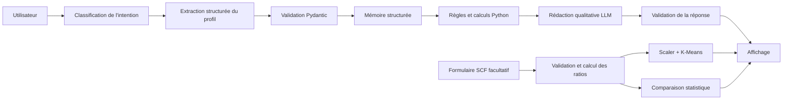

# Assistant Finance

Assistant pédagogique d’investissement développé dans le cadre de ma formation **AI Engineer chez Datagong**.

Le projet combine **LLM, règles métier Python et Machine Learning** pour analyser un profil d’épargnant, produire une allocation pédagogique et, de manière facultative, comparer certaines caractéristiques du profil à l’enquête américaine **Survey of Consumer Finances (SCF) 2022**.

L’objectif principal du projet est de séparer clairement les responsabilités :

- le **LLM** comprend le langage naturel et formule les explications ;
- **Python** valide les données, applique les règles et réalise tous les calculs numériques ;
- un modèle **K-Means** fournit une comparaison descriptive avec les profils observés dans le SCF ;
- des garde-fous contrôlent les réponses avant leur affichage.

> Ce projet est pédagogique. Il ne constitue pas un conseil financier personnalisé et ne fournit ni cours de marché en temps réel, ni prévision de rendement, ni signal de trading.

---

## Fonctionnalités principales

### Assistant conversationnel

L'utilisateur peut décrire sa situation en français.

Le système :

1. identifie l'intention de la demande ;
2. extrait les informations structurées du profil ;
3. valide et mémorise les informations déjà connues ;
4. demande uniquement les informations encore nécessaires ;
5. applique les règles Python ;
6. génère une explication qualitative contrôlée.

Le profil principal comprend notamment :

- le capital à investir ;
- l'horizon d'investissement ;
- la tolérance au risque déclarée ;
- l'épargne de précaution ;
- la résidence fiscale.

---

### Allocation pédagogique

Les allocations sont calculées par des **règles Python déterministes**.

Le LLM ne choisit donc pas lui-même les pourcentages.

Le projet distingue également :

- la **préférence de risque** déclarée par l'utilisateur ;
- sa **capacité à prendre du risque**, déterminée à partir de sa situation.

Si certaines conditions minimales ne sont pas respectées, notamment un horizon trop court ou une épargne de précaution insuffisante, l'affichage d'une allocation est suspendu.

---

### Comparaison facultative avec le SCF 2022

Après l'analyse principale, l'utilisateur peut choisir :

> **Oui, voir où je me situe**

Cette étape est totalement facultative.

Un formulaire séparé demande :

- l'âge ;
- l'épargne totale ;
- le montant investi en actions ;
- les liquidités disponibles ;
- le revenu mensuel ;
- la valeur totale des actifs ;
- les dettes.

Ces montants sont transformés en quatre variables comparables au SCF :

| Variable | Calcul / signification |
|---|---|
| Âge | âge renseigné |
| Part en actions | actions / patrimoine financier |
| Liquidités en mois de revenu | liquidités / revenu mensuel |
| Ratio dette / actifs | dettes / valeur totale des actifs |

Les graphiques situent ensuite l'utilisateur par rapport aux **4 532 ménages exploitables** de l'échantillon utilisé.

Cette comparaison est uniquement **descriptive** : elle ne détermine pas l'allocation d'investissement et ne définit pas ce qu'un utilisateur devrait faire.

---

## Architecture



L'orchestration principale se trouve dans :

```text
app/pipeline.py
```

Le même pipeline métier est utilisé par l'interface Streamlit et les autres points d'entrée du projet.

---

## Séparation LLM / Python

Un choix important du projet consiste à ne pas confier les calculs financiers au LLM.

### Le LLM est utilisé pour

- classifier la demande ;
- extraire les informations exprimées en langage naturel ;
- produire une explication qualitative.

### Python est utilisé pour

- valider les données ;
- mémoriser le profil ;
- calculer les allocations ;
- appliquer les seuils métier ;
- calculer les ratios SCF ;
- exécuter le clustering ;
- afficher les valeurs numériques finales.

Cette séparation permet de limiter les risques d'hallucination sur les chiffres.

---

## Profil structuré et validation

Les données utilisateur sont représentées avec **Pydantic**.

Les valeurs absentes restent explicitement représentées par `None`.

Une valeur égale à zéro reste au contraire une information connue :

```text
0    = valeur connue et nulle
None = information inconnue
```

Cette distinction est importante pour des données telles que les dettes ou la part actuellement investie en actions.

---

## Machine Learning

Le projet utilise un modèle **K-Means** construit à partir du **Survey of Consumer Finances 2022** de la Federal Reserve.

Les quatre variables utilisées sont :

```text
âge
part en actions
liquidités / revenu mensuel
dettes / actifs
```

Le pipeline ML contient notamment :

```text
bornage des variables
        ↓
StandardScaler
        ↓
K-Means
```

Le modèle utilisé par l'application est enregistré dans :

```text
models/segmentation.joblib
```

Il contient le pipeline complet ainsi qu'un seuil permettant de détecter les profils trop éloignés des données d'entraînement.

Dans ce cas, le système peut retourner :

```text
hors_distribution
```

plutôt que de forcer artificiellement l'utilisateur dans un cluster.

---

## Protocole d'entraînement

Les familles du SCF sont séparées entre **train** et **test**.

Le `StandardScaler` est ajusté uniquement sur les données d'entraînement afin d'éviter une fuite de données.

Plusieurs nombres de clusters ont été étudiés :

```text
K = 2
K = 3
K = 4
```

Le modèle à **3 clusters** a été conservé afin de privilégier la continuité du projet et la lisibilité de l'interprétation.

Le modèle à quatre clusters obtenait cependant une meilleure silhouette sur les configurations comparées. Ce choix est donc un compromis méthodologique et non l'affirmation que `K=3` constitue mathématiquement l'unique solution optimale.

La stabilité du clustering est également contrôlée sur plusieurs initialisations.

---

## Interface

L'application principale utilise **Streamlit**.

Elle propose deux parcours complémentaires :

### Formulaire principal

Permet de renseigner directement :

- le capital ;
- l'horizon ;
- l'épargne de précaution ;
- la tolérance au risque ;
- la résidence fiscale.

### Chat

Permet de fournir les mêmes informations progressivement en langage naturel.

Les informations déjà connues sont conservées dans une mémoire structurée afin d'éviter de redemander inutilement les mêmes données.

---

## Technologies utilisées

```text
Python
Streamlit
Pydantic
OpenAI API
pandas
NumPy
scikit-learn
Matplotlib
joblib
unittest
```

---

## Installation

### 1. Cloner le dépôt

```bash
git clone https://github.com/Vlady19/assistant-finance.git
cd assistant-finance
```

### 2. Créer l'environnement Python

L'environnement de référence utilisé pour le projet est **Python 3.14.4 sur macOS Apple Silicon**.

```bash
python3.14 -m venv .venv
source .venv/bin/activate
```

### 3. Installer les dépendances

```bash
python -m pip install -r requirements.txt
```

Les versions utilisées lors de la validation du projet sont également conservées dans :

```text
requirements-lock.txt
```

### 4. Configurer la clé OpenAI

Créer un fichier `.env` à partir de :

```text
.env.example
```

puis définir :

```text
OPENAI_API_KEY=...
```

Le fichier `.env` est exclu du dépôt Git et ne doit jamais être versionné.

Le modèle OpenAI peut être configuré avec :

```text
OPENAI_MODEL
```

Un changement de modèle nécessite idéalement de rejouer les évaluations du projet.

---

## Lancement

La méthode principale est :

```bash
python lancer_local.py
```

Le formulaire principal peut fonctionner sans appel API.

Les fonctionnalités conversationnelles nécessitent une clé OpenAI valide.

Il est également possible d'utiliser une configuration `.env` située ailleurs :

```bash
python lancer_local.py --env-file /chemin/vers/votre/.env
```

---

## Tests

Les tests locaux peuvent être exécutés sans coût API :

```bash
python -m unittest discover -s tests -v
python -m pip check
```

Ils couvrent notamment :

- les modèles Pydantic ;
- la mémoire du profil ;
- les règles d'allocation ;
- le clustering ;
- la séparation train/test ;
- le calcul indépendant des distances K-Means ;
- les profils hors distribution ;
- la gestion d'un modèle ML indisponible ;
- les garde-fous de rédaction ;
- l'interface Streamlit ;
- la comparaison SCF ;
- les scénarios de panne API.

---

## Évaluations LLM

Deux évaluations utilisent de vrais appels API :

```bash
python -m evals.lancer
python -m evals.parcours
```

Elles couvrent notamment :

- la classification des intentions ;
- l'extraction structurée ;
- les parcours utilisateur complets ;
- la conservation du profil entre plusieurs messages.

Les résultats sont enregistrés dans :

```text
reports/evaluation_classification.json
reports/evaluation_parcours.json
```

Ces évaluations constituent des tests de régression du projet et ne doivent pas être interprétées comme un taux universel de fiabilité du chatbot.

---

## Structure du projet

```text
assistant-finance/
│
├── app/
│   ├── clustering.py
│   ├── comparaison_scf.py
│   ├── config.py
│   ├── conversation.py
│   ├── entrainement.py
│   ├── features.py
│   ├── intents.py
│   ├── inventaire_donnees.py
│   ├── llm.py
│   ├── models.py
│   ├── pipeline.py
│   ├── preparer_donnees.py
│   ├── redaction.py
│   ├── regles.py
│   ├── validation.py
│   └── vue_comparaison.py
│
├── data/
├── evals/
├── examples/
├── models/
├── notebooks/
├── reports/
├── tests/
│
├── app_streamlit.py
├── infer.py
├── lancer_local.py
├── main.py
├── requirements.txt
└── README.md
```

---

Les fichiers Python commencent par une description de leur rôle. Les fichiers
de données, modèles et résultats sont décrits dans les dossiers correspondants :

- [Données SCF](data/README.md) et [sources brutes](data/raw/README.md).
- [Profil JSON d'exemple](examples/README.md).
- [Modèles enregistrés](models/README.md).
- [Rapports et journaux de validation](reports/README.md).

`inventaire_livraison.json` conserve l'inventaire et les empreintes d'une livraison
historique. Il ne constitue pas un inventaire actualisé après chaque modification.

## Reproductibilité des données

Le dépôt ne versionne pas directement les données brutes du SCF.

Le script de préparation est disponible :

```bash
python -m app.preparer_donnees
```

L'entraînement peut ensuite être exécuté avec :

```bash
python -m app.entrainement
```

L'EDA peut être rejouée avec :

```bash
python -m notebooks.eda_clustering
```

Une inférence peut également être testée à partir d'un profil d'exemple :

```bash
python infer.py examples/profil_complet.json
```

---

## Limites du projet

Ce projet reste volontairement limité à un cadre pédagogique.

Les principales limites sont les suivantes :

- les allocations reposent sur des règles fixes et ne constituent pas une optimisation de portefeuille ;
- le SCF décrit des ménages américains et ses résultats ne sont pas directement transposables à tous les épargnants français ;
- un seul implicat du SCF est utilisé pour le clustering ;
- les distributions affichées sont descriptives et ne définissent pas un comportement financier optimal ;
- aucune donnée boursière ou performance de marché en temps réel n'est utilisée ;
- aucune prévision de rendement ou de prix n'est produite ;
- les informations fiscales générales peuvent évoluer et le projet ne contient pas de moteur réglementaire ;
- les contrôles appliqués aux réponses du LLM réduisent certains risques mais ne constituent pas une preuve formelle de vérité de chaque phrase générée ;
- la mémoire conversationnelle conserve principalement les informations structurées du profil et non l'intégralité du raisonnement conversationnel ;
- le projet n'exécute pas de code Python généré dynamiquement par le LLM : les outils métier sont des fonctions Python prédéfinies et contrôlées.

---

## Ce que ce projet met en œuvre

Ce projet m'a permis de travailler sur l'ensemble d'une petite application IA, depuis les données jusqu'à l'interface :

```text
traitement de données
        ↓
Machine Learning
        ↓
API LLM
        ↓
sorties structurées
        ↓
règles métier
        ↓
validation et garde-fous
        ↓
tests
        ↓
interface Streamlit
```

L'objectif n'était pas uniquement de produire un chatbot, mais de construire une architecture dans laquelle **le langage naturel, les calculs déterministes et le Machine Learning ont des responsabilités clairement séparées**.

---

## Sources

- [Survey of Consumer Finances — Federal Reserve](https://www.federalreserve.gov/econres/scfindex.htm)
- [SCF — documentation méthodologique](https://www.federalreserve.gov/econres/scf-documentation.htm)
- [Définitions des agrégats SCF](https://www.federalreserve.gov/econres/files/bulletin.macro.txt)
- [SCF 2022 — dictionnaire SDA](https://sda.berkeley.edu/sdaweb/docs/scfcomb2022/DOC/hcbk0001.htm)
- [OpenAI — Structured Outputs](https://developers.openai.com/api/docs/guides/structured-outputs)
